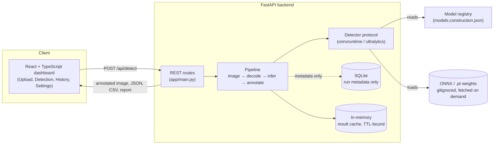

# VisionDetect — AI Object Detection Dashboard

Upload an image, run a real YOLO detection model over it, and get bounding
boxes, per-class counts, confidence statistics, an annotated image and
downloadable results.

The detection is genuine: a YOLO11n network runs on your machine through
ONNX Runtime or PyTorch. Nothing in this application fabricates, samples or
hardcodes a detection — including the construction-specific models described
below, whose accuracy and failure modes are documented rather than assumed.

---

## Contents

- [What it does](#what-it-does)
- [Architecture](#architecture)
- [Requirements](#requirements)
- [Setup](#setup)
- [Running it](#running-it)
- [CPU and GPU](#cpu-and-gpu)
- [Configuration](#configuration)
- [API](#api)
- [Construction and interior fit-out classes](#construction-and-interior-fit-out-classes)
- [Using a custom model](#using-a-custom-model)
- [Tests](#tests)
- [Troubleshooting](#troubleshooting)
- [Project structure](#project-structure)
- [Known limitations](#known-limitations)
- [Licence](#licence)

---

## What it does

1. You upload a JPG, PNG or WEBP image (drag, paste or browse).
2. The backend decodes and validates it, then runs the configured detection
   model.
3. Every detected object comes back with a class name, a confidence score,
   bounding-box corners, width, height, centre and area — in the **original
   image's** pixel coordinates.
4. The dashboard draws the boxes over your image, summarises the run, charts
   the class distribution, and lists every object in a sortable table.
5. You can filter classes, change thresholds and re-run, and download the
   annotated image, the JSON, a CSV or a text report.

Filtering a class updates the overlay, the summary cards, both charts and the
table together, so the numbers on screen always describe exactly the objects
being shown.

---

## Architecture



A model is a `ModelSpec` — a registry key, a backend (`onnx` or `ultralytics`)
and a weights path. Class names, input size and task are read from the
checkpoint's own metadata at load time, so swapping in a different model is a
config change, not a code change. See
[`backend/app/detector.py`](backend/app/detector.py) for the inference
abstraction and [`backend/app/pipeline.py`](backend/app/pipeline.py) for how a
request turns into a result.

**Product note:** uploaded images are never written to disk by default — they
live in memory for the result TTL so a threshold change can re-run without a
re-upload, then they're dropped. History is metadata only (filename,
timestamp, counts, timings). That default, and the reasoning behind it, is a
product decision as much as an engineering one — see
[What is stored](#what-is-stored).

---

## Requirements

- **Python 3.11+** (developed and tested on 3.13)
- **Node.js 20+** (developed and tested on 24) — only needed to build or
  develop the dashboard
- Roughly **1.5 GB of free memory** for the ONNX backend, more for PyTorch

---

## Setup

### 1. Backend

From the repository root:

```bash
python -m venv .venv
```

Activate it — on Windows (PowerShell):

```powershell
.venv\Scripts\Activate.ps1
```

or on macOS / Linux:

```bash
source .venv/bin/activate
```

Then install the dependencies:

```bash
pip install -r backend/requirements.txt
```

> `requirements.txt` includes `ultralytics`, which pulls in PyTorch (a large
> download). If you only need the ONNX models, delete the `ultralytics` line
> first — everything except the `yolo11n-pt` model still works.

### 2. Model weights

This project reads weights from the repository's `models/` directory. If
`models/yolo11n.onnx` is already there, **there is nothing to download.**

To produce it from scratch:

```bash
python -m scripts.export_model --model yolo11n
```

Or point the app at weights you already have:

```bash
export VISIONAI_WEIGHTS_DIR=/path/to/your/weights
```

The `yolo11n-pt` model needs no local file at all — Ultralytics downloads
`yolo11n.pt` on first use (~5 MB), provided the machine has network access.

### 3. Frontend

```bash
npm install --prefix frontend
```

---

## Running it

There are two ways to run this, and on a machine that is short of memory the
second one matters.

### Option A — two processes (best for developing the UI)

Terminal 1, the API:

```bash
cd backend && python -m uvicorn app.main:app --reload --port 8000
```

Terminal 2, the dashboard:

```bash
npm run dev --prefix frontend
```

Then open **http://localhost:5173**. The Vite dev server proxies `/api` to port
8000, so there is no CORS configuration to do and hot reload works.

| Service   | URL                     |
| --------- | ----------------------- |
| Dashboard | http://localhost:5173   |
| API       | http://localhost:8000   |
| API docs  | http://localhost:8000/docs |

### Option B — one process (lighter, good for just using it)

Build the dashboard once, then let the API serve it:

```bash
npm run build --prefix frontend
cd backend && python -m uvicorn app.main:app --port 8000
```

Then open **http://localhost:8000**. One process, one port, no proxy. This
needs about 400 MB less memory than running the Vite dev server alongside.

---

## CPU and GPU

CPU is the default and needs no configuration. On a typical laptop CPU, an
810×1080 image takes roughly **40 ms** of inference and **120 ms** end to end.

For an NVIDIA GPU, replace the runtimes with their CUDA builds:

```bash
pip uninstall onnxruntime
pip install onnxruntime-gpu
# and, for the ultralytics backend, a CUDA build of torch:
# see https://pytorch.org/get-started/locally/
```

then:

```bash
export VISIONAI_DEVICE=cuda
```

`GET /api/health` reports the device actually in use, and the dashboard shows
it in the top bar — so you can confirm the GPU is really being used rather than
assuming. Setting `VISIONAI_DEVICE=cuda` when no CUDA device is available is a
hard error rather than a silent fallback to CPU.

---

## Configuration

All settings are environment variables, read once at startup.

| Variable | Default | Meaning |
| --- | --- | --- |
| `VISIONAI_WEIGHTS_DIR` | `<repo>/models` | Where model weights are resolved from |
| `VISIONAI_DEFAULT_MODEL` | `yolo11n` | Model used when a request names none |
| `VISIONAI_DEVICE` | `auto` | `auto`, `cpu` or `cuda` |
| `VISIONAI_CONFIDENCE_THRESHOLD` | `0.35` | Default confidence threshold |
| `VISIONAI_IOU_THRESHOLD` | `0.45` | Default IoU threshold for NMS |
| `VISIONAI_MAX_UPLOAD_MB` | `15` | Largest accepted upload |
| `VISIONAI_RESULT_TTL_SECONDS` | `3600` | How long a result stays retrievable |
| `VISIONAI_HISTORY_ENABLED` | `true` | Write analysis metadata to SQLite |
| `VISIONAI_HISTORY_DB` | `backend/data/history.db` | History database path |
| `VISIONAI_PERSIST_UPLOADS` | `false` | Write uploaded images to disk |
| `VISIONAI_CORS_ORIGINS` | localhost 5173/4173 | Comma-separated allowed origins |
| `VISIONAI_MODELS_FILE` | — | JSON model registry, replaces the built-in one |

See `backend/.env.example`.

### What is stored

By default, **uploaded images are never written to disk.** They are held in
memory for the result TTL so that changing the thresholds can re-run the model
without a re-upload, and are dropped after that.

Detection *history* is metadata only — filename, timestamp, counts, timings,
settings. It never includes the image. Set `VISIONAI_PERSIST_UPLOADS=true` if
you do want uploads saved to `backend/data/uploads/`.

---

## API

| Method | Path | Purpose |
| --- | --- | --- |
| `GET` | `/api/health` | Health, model readiness, inference device |
| `GET` | `/api/models` | Configured models and whether each can be served |
| `POST` | `/api/detect` | Detect on an uploaded image |
| `POST` | `/api/results/{id}/rerun` | Re-run on the held image with new settings |
| `GET` | `/api/results/{id}` | Re-fetch a result |
| `GET` | `/api/results/{id}/image` | Annotated image (PNG or JPEG) |
| `GET` | `/api/results/{id}/json` | Detection results as JSON |
| `GET` | `/api/results/{id}/csv` | Detection table as CSV |
| `GET` | `/api/results/{id}/report` | Text summary report |
| `GET` | `/api/history` | Past analyses (metadata only) |
| `DELETE` | `/api/history/{id}` | Delete one history entry |
| `DELETE` | `/api/history` | Clear history |

Interactive documentation is at `/docs`.

### Example

```bash
curl -s -X POST http://localhost:8000/api/detect \
  -F "file=@photo.jpg" \
  -F "confidence_threshold=0.35" \
  -F "iou_threshold=0.45"
```

```jsonc
{
  "result_id": "det_6bb604fbdb10",
  "image": { "filename": "bus.jpg", "width": 810, "height": 1080, "format": "jpeg", "size_bytes": 137419 },
  "model": "yolo11n",
  "processing_time_ms": 128.2,
  "inference_time_ms": 35.6,
  "summary": {
    "total_objects": 5,
    "unique_classes": 2,
    "max_confidence": 0.9409,
    "avg_confidence": 0.7801,
    "class_counts": { "person": 4, "bus": 1 }
  },
  "detections": [
    {
      "object_id": 1,
      "class_name": "bus",
      "confidence": 0.9409,
      "bbox": { "x_min": 12, "y_min": 228, "x_max": 798, "y_max": 734 },
      "width": 786,
      "height": 506,
      "center": { "x": 405.0, "y": 481.0 },
      "color": "#cd9200"
    }
  ]
}
```

### Status codes

| Code | When |
| --- | --- |
| `200` | Success, including an image with zero detections |
| `422` | The image is unusable, or a parameter is out of range |
| `404` | The result is no longer held in memory |
| `503` | No model can be served; the message says what would fix it |
| `500` | The annotated image could not be encoded (usually low memory) |

---

## Construction and interior fit-out classes

COCO has no word for a column, a cable tray or a hard hat, and no amount of
configuration adds one to a closed-set model — the weights have no such output.
There are two ways to get construction classes, and the registry ships both:

| Model | Classes | Evidence |
| --- | --- | --- |
| `ppe-construction` | 19 — hard hat, vest, gloves, boots, mask, eye/ear protection, worker, the *not-worn* counterparts, fire extinguisher, welding equipment, circular saw | **Fine-tuned**, not prompted. Detects PPE that open-vocabulary scores 0.000 on. Needs one fetch command |
| `construction-hazard` | 11 — hardhat, mask, safety vest and *not-worn* counterparts, person, safety cone, machinery, vehicle, utility pole | **Fine-tuned.** Adds plant, vehicles and site layout. AGPL-3.0 — copyleft, check before shipping |
| `construction-calibrated` | 4 — exposed slab, light, column, partition | Open-vocabulary, calibrated against sample site imagery; reports only what measurably worked |
| `fitout-extended` | 38 — scaffolding, wiring, cable tray, helmet, hi-vis vest, duct, pipe, conduit, sprinkler, window, glass partition, suspended ceiling, socket/switch, electrical panel, debris, stored materials, … | Mixed: a handful measured and working, several measured and failing, the rest untested |

`ppe-construction` and `construction-hazard` are models trained on construction
photographs. The other two use YOLO-World, an open-vocabulary detector that
takes class names as text at inference time — which is how a construction
vocabulary exists at all without a labelled dataset. Select any of them in the
dashboard's model picker; the confidence slider drops to the threshold that
model is worth running at, because open-vocabulary scores sit far below a
closed-set model's.

The fine-tuned models are not bundled — weights are gitignored, and a
community-trained checkpoint is worth an explicit decision rather than an
implicit download. Fetch one with:

```bash
cd backend
python scripts/fetch_model.py --model ppe-construction
```

That downloads the checkpoint, **audits its pickle without executing it**,
converts it to ONNX and deletes the original. A `.pt` is a pickle and loading
one runs its author's code; the audit refuses anything referencing a module
outside an allowlist, and the served artefact is ONNX, which is data rather
than a program. Run `--list` to see what is available and under what licence.

**Read `backend/models.construction.md` before trusting a result.** It records
what is measured, what is untested, and what is known to fail — including why
the same open-vocabulary prompt can score five times higher or lower depending
on what else is in the prompt set.

---

## Using a custom model

The detector is a replaceable module. Class names, network input size and task
are read from the checkpoint's **own metadata**, so a model trained on
construction objects — columns, helmets, cable trays — reports those class names
with no code change.

Write a registry file:

```json
[
  {
    "name": "site-objects",
    "backend": "onnx",
    "weights": "site-objects.onnx",
    "label": "Construction objects (custom)",
    "description": "Fine-tuned on site imagery"
  }
]
```

and point the service at it:

```bash
export VISIONAI_MODELS_FILE=/path/to/models.json
export VISIONAI_DEFAULT_MODEL=site-objects
```

Models appear in the dashboard's model picker with their availability status.
Open-vocabulary checkpoints (YOLO-World style) are supported through the
`ultralytics` backend by adding a `prompts` array to the entry — the prompts
become the class vocabulary.

---

## Tests

```bash
python -m pytest backend/tests -c backend/pytest.ini --rootdir backend
```

The suite runs the real model rather than a mock. It asserts against the
published results for the two canonical YOLO sample images that ship inside the
installed `ultralytics` package — `bus.jpg` (one bus, four people) and
`zidane.jpg` (two people, one tie) — which verifies head decoding,
non-maximum suppression and the letterbox inverse together. Tests that need
those images skip cleanly if `ultralytics` is not installed.

It also covers summary/detection consistency, box containment within the
original image, threshold behaviour, re-runs, every export format, zero-detection
images, and the rejection of empty, truncated, oversized and non-image uploads.

---

## Troubleshooting

**`Model weights not found at ...`**
`GET /api/health` and the Settings page both name the exact path searched.
Either place the weights there, run `python -m scripts.export_model`, or set
`VISIONAI_WEIGHTS_DIR`.

**The dashboard says "Backend offline"**
The API is not running or not on port 8000. Start it, then press the refresh
icon in the top bar. If it is on another port, set `VITE_API_TARGET` for the
dev server.

**`FATAL ERROR: ... JavaScript heap out of memory` when starting Vite, or
`VirtualAlloc ... errno=1455`**
The machine is out of memory or out of Windows pagefile. Use
[Option B](#option-b--one-process-lighter-good-for-just-using-it) — build the
dashboard once and let the API serve it, which avoids running Node at all.
Increasing the Windows pagefile also fixes it.

**`ImportError: DLL load failed while importing cv2: The paging file is too
small`**
The same problem on the Python side. Close other applications, or increase the
pagefile.

**`Could not encode the annotated image`**
A memory failure inside the image encoder. Retry; restart the backend if it
persists.

**Detection works but finds nothing**
COCO models know 80 everyday object classes and nothing else. They have no
class for a wall, duct, column or pipe, so on construction imagery they will
legitimately report very little. Lower the confidence threshold to see marginal
detections, and see [Known limitations](#known-limitations).

**Loading a third model fails mid-inference**
At most two models stay resident at once (`max_loaded_models`); a third evicts
the least recently used. If a load still fails, memory is the constraint — use
the ONNX models, which are far lighter than the PyTorch one.

---

## Project structure

```
.
├── backend/
│   ├── app/
│   │   ├── config.py        Settings and the model registry
│   │   ├── detector.py      Inference backends, decoding, NMS, class colours
│   │   ├── image_utils.py   Decode, validate, annotate, encode
│   │   ├── pipeline.py      Image in, structured result out
│   │   ├── schemas.py       Request and response models
│   │   ├── results.py       In-memory result cache
│   │   ├── history.py       SQLite metadata log
│   │   ├── exports.py       CSV and report generation
│   │   └── main.py          FastAPI routes
│   ├── scripts/fetch_model.py   Audited download + ONNX conversion for third-party checkpoints
│   ├── tests/                   End-to-end tests against the real model
│   ├── models.construction.json Construction/PPE model registry
│   ├── models.construction.md   What each construction model is measured to do
│   ├── requirements.txt
│   └── .env.example
├── frontend/
│   ├── src/
│   │   ├── components/      Upload, viewer, charts, table, settings, exports
│   │   ├── pages/           Dashboard, Detection, History, Settings
│   │   ├── services/api.ts  Backend client
│   │   ├── types/           Mirrors of the API models
│   │   └── lib/             Formatting and colour helpers
│   ├── package.json
│   └── vite.config.ts
├── scripts/export_model.py  Exports a COCO checkpoint to ONNX for the serving path
├── models/                  Weights live here, gitignored — see models/README.md
└── README.md
```

---

## Known limitations

**The model's vocabulary is the real constraint.** YOLO11n is trained on COCO:
80 everyday object classes. It can count people, chairs, laptops and bottles. It
has no concept of a wall, beam, duct or sprinkler head, so its silence about
those is not evidence of their absence. Detecting construction elements needs
either a construction-trained checkpoint or an open-vocabulary model — both of
which this application can load (see
[Using a custom model](#using-a-custom-model)), but neither of which is what
ships by default.

**Colour cannot identify 80 classes on its own.** Each class gets a stable
colour derived from its index, generated in OKLCH so every hue carries the same
weight. The palette was tuned against a colour-contrast validator and passes on
lightness, chroma and normal-vision separation — but no categorical palette of
this size can also be safe for red-green colour blindness. Colour is therefore
never the only label: every box, bar, legend entry and table row carries its
class name as text.

**Results live in memory.** A result is retrievable for one hour by default.
After that its downloads 404 and the image must be uploaded again. This is a
deliberate privacy default, not an oversight.

**Segmentation masks are not used.** The `yolo11n-seg` model is served for its
detection head only; its mask coefficients are decoded but discarded.

**The frontend bundle is one large chunk**, most of it the charting library.
Fine over localhost; it would want code-splitting before any real deployment.

**No screenshots yet.** This README documents real, working behaviour, but a
captured screenshot of the dashboard hasn't been added to this repository yet.

---

## Licence

This project's own code is MIT-licensed — see [LICENSE](LICENSE).

It optionally depends on the `ultralytics` package (AGPL-3.0) for the
PyTorch inference backend and for fetching construction-specific checkpoints;
the default ONNX Runtime serving path has no such dependency. See
[models/README.md](models/README.md) for what that means if you plan to
deploy this as a hosted service rather than run it locally.
